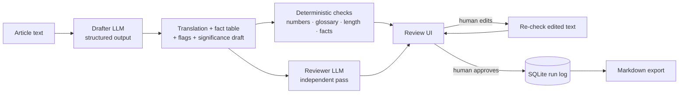

# Rāṣid (راصد)

**AI-assisted news-brief translation between Arabic and Malay/English, with deterministic checks, an independent AI reviewer, and the human translator as the final decision-maker.**

> **The AI drafts and checks. The human decides.**

> **Status:** Phases 0–4 complete (drafting, deterministic checks, reviewer pass, review UI, run log). Phase 5 (evaluation on public news) is in progress; results will be published below with real numbers only.

<!-- Replace with a 20–30 second GIF: paste article → draft → red check → fix → approve -->
<!--  -->

---

## Why this exists

LLMs translate fluently, and fluency is exactly the problem: a wrong number, a dropped clause, or a softened attribution reads just as smoothly as a correct sentence. In news briefs, one wrong figure or name is a factual error that a reader will act on.

A chat assistant can draft a translation. It can't *prove* the draft is faithful, keep terminology consistent across hundreds of briefs, or tell you how much time review actually takes. Rāṣid wraps the LLM in the parts that need to be reliable:

| Need | How Rāṣid handles it |
|---|---|
| Every number transferred correctly | Deterministic check in code, not an LLM opinion |
| Consistent terminology | Glossary enforcement in both directions |
| Omissions and mistranslations caught | Independent reviewer pass that compares source and translation |
| Nothing ships unreviewed | No "final" output exists until a human approves it |
| Know whether it actually helps | Review time and human edit rate logged per brief |

## Supported directions

| Direction | Source | Target style |
|---|---|---|
| `ms → ar`, `en → ar` | Malaysian news in Malay or English | Formal Modern Standard Arabic, wire-service (WAM) style |
| `ar → ms`, `ar → en` | Arabic-language news | Standard Malay or British English, Bernama style |

Direction is detected from the script automatically, or set explicitly.

## How it works



1. **Draft.** The drafter returns a schema-validated result (Pydantic + structured outputs): the full translation, a table of every name, number, date, rank and organisation in source and target form, uncertainty flags, and a clearly marked draft of the significance section.
2. **Check (no LLM).** Four deterministic checks run on the draft, and again on the human's edited text:
   - `numbers`: every number in the source appears in the translation, as a multiset, after normalising Arabic-Indic digits and thousands separators
   - `glossary`: every glossary term found in the source uses an accepted translation, with Arabic matching that ignores diacritics and handles attached prefixes
   - `length_ratio`: translation/source word ratio within a direction-specific band, to catch silent summarising
   - `fact_table`: every fact the drafter listed actually appears in the translation
3. **Review.** A second LLM call, with its own system prompt, compares source and translation and reports issues by severity (`critical` / `major` / `minor`) and category (omission, addition, mistranslation, terminology, grammar, style).
4. **Decide.** The human edits in the Gradio UI, re-runs the checks on their edits, writes the source assessment themselves, and approves. Review time and edit rate are logged against a manual baseline.

### Design decisions

- **Checks are aids, not judges.** A false alarm costs the reviewer a few seconds; a missed error reaches a reader. Every check is tuned toward recall.
- **The human writes the judgement lines.** The significance section is always labelled a draft, and the source assessment is human-only.
- **One module talks to the provider.** All API calls live in `llm.py`, so a local model can replace the hosted one without touching the rest of the code.
- **Long fixed prompts are cached.** The rules, glossary, and style notes form a stable system prompt, so prompt caching cuts the cost of repeated calls.
- **Retries are explicit.** Rate limits, 5xx, and network errors are retried with exponential backoff. A 400 is treated as a bug and never retried.
- **Article text is data.** Prompts wrap the article in tags and tell the model to ignore any instructions inside it.

### Known limits (documented, not hidden)

- Numbers written as words ("dua", "two", "ثلاثة") and scale words ("bilion" → "مليار") are invisible to the number check. The fact table and reviewer cover them.
- Arabic matching handles diacritics, quotation marks, and the لل contraction, but not full morphology. A fact written as "الرئيس التنفيذي" is not found in "رئيسها التنفيذي" ("its chief executive"), because Arabic attaches the possessive to the word. Fixing this needs morphological analysis (camel-tools), planned for Phase 7.

## Results

> **Phase 5 in progress.** This section will report real numbers from an evaluation on 20–24 public news articles with human gold translations. Misses will be reported and explained, not hidden.

| Metric | Result |
|---|---|
| Review time vs manual baseline | *pending* |
| Human edit rate (character-level) | *pending* |
| Reviewer catch rate on planted errors | *pending* |
| Number/glossary errors caught by checks | *pending* |
| Cost per brief | *pending* |

The reviewer acceptance test (`evals/reviewer_plant_test.py`) plants an omission and an attribution or grammar error in real drafts, then requires the reviewer to report the omission as critical or major in at least 4 of 5 runs.

## Quick start

Requirements: Python 3.11+, [uv](https://docs.astral.sh/uv/), and an Anthropic API key.

```bash
git clone https://github.com/ihsanhadhrami/Rasid-AI-assisted-translator.git
cd Rasid-AI-assisted-translator
uv sync
cp .env.example .env        # then set ANTHROPIC_API_KEY (and optionally RASID_PASSWORD)
uv run python -m rasid.app  # open http://127.0.0.1:7860
```

On Windows, you can double-click `Rasid.bat` instead.

### Command line

```bash
# Draft, check, and review one article (direction auto-detected)
uv run python -m rasid.cli evals/articles/001.txt --source "Defence Security Asia" --date 2026-10-13

# Arabic source to English, saving the full run as JSON
uv run python -m rasid.cli evals/articles/003.txt --to en --out runs/003_en.json

# Re-run checks only on a saved draft (no API call)
uv run python -m rasid.cli evals/articles/003.txt --to en --check runs/003_en.json
```

### Configuration

| Variable | Default | Purpose |
|---|---|---|
| `ANTHROPIC_API_KEY` | required | API key, read from `.env` only |
| `RASID_MODEL` | `claude-sonnet-5-5` | Model for drafter and reviewer |
| `RASID_PASSWORD` | none | Protects the UI |
| `RASID_MAX_TOKENS` | `32000` | Output ceiling per call |

### Tests

```bash
uv run pytest
```

Tests cover Arabic normalisation, script detection and direction resolution, glossary matching, every deterministic check, pipeline wiring and storage.

## Repository layout

```
src/rasid/
  pipeline.py     draft → checks → review; approval
  checks.py       deterministic checks (no LLM)
  llm.py          the only module that calls the model provider
  arabic.py       digit conversion and normalisation
  glossary.py     loading and bidirectional term matching
  languages.py    script detection and direction rules
  schemas.py      Pydantic models for every LLM output
  storage.py      SQLite run log, edit rate
  export.py       Markdown export
  app.py          Gradio review UI (UI only, no logic)
  cli.py          command-line runner
prompts/          drafter (to/from Arabic) and reviewer system prompts
data/             glossary.csv, style notes and brief templates per language
evals/            public eval articles + sources, reviewer acceptance test
tests/            pytest suite
SPEC.md           full build specification
```

## Data and privacy

- Public news only. Nothing internal or confidential belongs in this tool without the owning organisation's approval.
- `.env`, `runs/`, `*.db` and `data/private/` are git-ignored.
- Runs locally on `127.0.0.1` by default.
- Eval articles are listed with outlet, date, and URL in `evals/articles/SOURCES.md`.

## Roadmap

- [x] Phase 0–3: setup, drafting in both directions, deterministic checks, reviewer pass
- [x] Phase 4: Gradio review UI, SQLite run log, Markdown export
- [ ] Phase 5: evaluation on public news, with published numbers
- [ ] Phase 6: DOCX export with right-to-left support, public demo, write-up
- [ ] Phase 7: morphological matching (camel-tools), URL ingestion, local-model option

## Author

Built by **Ihsan Hadhrami**: Arabic–Malay–English, degree in Arabic Language and Literature (Jordan), building Arabic-English LLM applications.

Related project: [Musaid](https://github.com/ihsanhadhrami/musaid-crosslingual-rag), cross-lingual support RAG over an English-only knowledge base.
